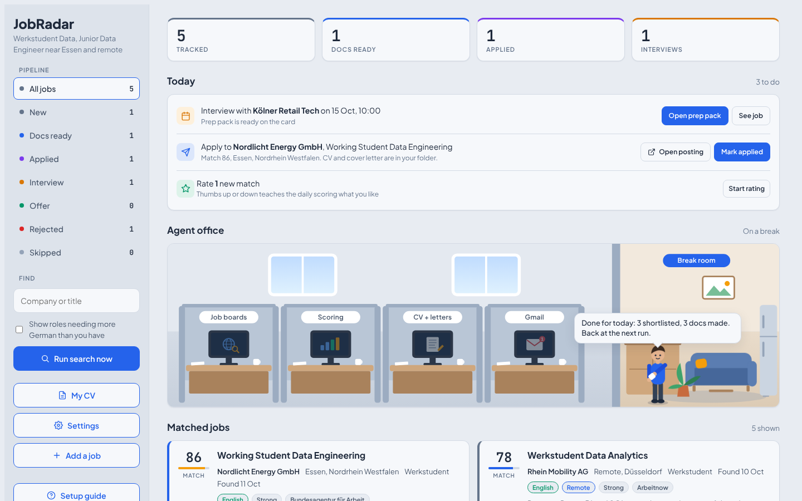

# Job Hunt Pipeline

[](https://github.com/srvskr1/job-hunt-pipeline/actions/workflows/tests.yml)

A local, open source job hunt assistant for Germany. Every day it collects fresh job ads from public APIs, scores them against your CV, writes a tailored CV and cover letter for the best matches, and shows everything on a dashboard in your browser. It runs on your own computer. Your CV and your data never leave it, except for the AI model you choose.



It never applies for you and never contacts companies. You stay in control of every application.

## What it does

* **Starts from your CV.** Drop it on the dashboard (or run `jobhunt import cv.pdf`) and it turns your existing CV (PDF, DOCX or text) into a profile. Every bullet is checked against your original, and anything the AI left out or made up is flagged.
* **Collects jobs** from the Bundesagentur für Arbeit, Arbeitnow, Adzuna and TheirStack (the last two with your own free keys). It removes duplicates across sources.
* **Watches your dream companies.** Name companies that use Greenhouse, Lever, Ashby, Personio or SmartRecruiters, and their new roles show up every day, often before they reach the job boards. `jobhunt watch <careers link>` finds the right entry.
* **Takes jobs you found yourself.** Paste a link or the ad text (from LinkedIn, a friend, anywhere) with `jobhunt add` or the dashboard's "Add a job" panel. It gets scored and tailored like the rest.
* **Understands German job ads.** It reads the German level an ad really asks for (A1 to C2, from phrases like "verhandlungssicher" or "gute Deutschkenntnisse"), compares it with yours, and gives you an English summary of German ads. It writes German cover letters only if your German is B2 or better, because a polished German letter from someone at A2 would suggest a level they do not have.
* **Scores each job** from 0 to 100 against your profile, with a short reason and honest gaps. Ads that demand fluent German are flagged and skipped (you can switch that off).
* **Learns your taste.** Give jobs a thumbs up or down on the dashboard and the next run leans toward what you liked.
* **Tailors your CV truthfully.** It reorders and selects facts from your profile. It never invents experience. A guard rejects generated text that mentions numbers, tools or language levels your profile does not back up, and falls back to safe text.
* **Writes a cover letter** and a short report per job: what the ad asks for, what your CV covers, and which gaps to be honest about.
* **Exports DOCX and PDF** (PDF needs LibreOffice).
* **Optional Gmail sync** (read only) moves statuses forward when confirmations, interview invitations or rejections arrive.
* **Daily digest to you** by Telegram or email: top new matches, CVs ready to send, interviews.
* **Dashboard**: a Today list of what to do next, a pipeline you can filter, notes per job, interview prep, reply rates by source, the skill gaps employers mention most, a weekly summary, and a small animated office that shows what the run is doing.

## Quick start

**New to Python or the terminal?** Follow [INSTALL.md](INSTALL.md): step by step for Windows, macOS, Linux and Docker, from installing Python to your first search.

You need Python 3.11 or newer (or Docker, see below). Works on Windows, macOS and Linux. On Debian or Ubuntu also install `python3-venv`. On Windows use `python` where the commands below say `python`; on macOS and Linux it may be `python3`.

```bash
git clone https://github.com/srvskr1/job-hunt-pipeline.git
cd job-hunt-pipeline
python -m venv .venv
# Windows: .venv\Scripts\activate    macOS or Linux: source .venv/bin/activate
pip install -e .

mkdir my-hunt && cd my-hunt
jobhunt init      # creates config.toml, profile.toml and .env
jobhunt demo      # optional: fictional sample jobs, to look around first
jobhunt serve     # open http://127.0.0.1:8765
```

Prefer Docker? No Python needed:

```bash
mkdir data
docker compose build
docker compose run --rm jobhunt init
docker compose up -d      # http://127.0.0.1:8765
```

See [docs/docker.md](docs/docker.md) for daily runs and details.

Then make it yours, all on the dashboard. The **Setup guide** opens by itself the first time and walks you through it:

1. **My CV**: drop your CV file, check the form, add anything missing, save. Bullets are copied word for word, so keep them short and true.
2. **Settings**: job titles, city, job sources and their keys, and your AI model.
3. **Run search now**.

Prefer files? Everything is also in `profile.toml`, `config.toml` and `.env`, and `jobhunt run` searches from the terminal. `jobhunt doctor` checks the setup.

To start fresh after the demo, delete `jobhunt.db`.

## Choosing an AI model

Set `[llm]` in `config.toml`:

| provider | what you need | notes |
|---|---|---|
| `none` | nothing | Keyword scoring and template letters. Works offline, less precise. |
| `ollama` | Ollama running, a pulled model | Local and free. Nothing leaves your computer. |
| `lmstudio` | LM Studio with its server started | Local and free. |
| `llamacpp`, `vllm`, `local` | a running server | Any OpenAI compatible local server. |
| `anthropic` | `ANTHROPIC_API_KEY` in `.env` | Claude through the Anthropic API. |
| `openai` | `OPENAI_API_KEY` in `.env` | OpenAI API. |

### Which local model?

Use a 7B model or larger. Pick an instruction tuned version ("instruct" or "chat"), because the tool asks for JSON answers.

| your computer | try |
|---|---|
| 8 GB RAM, no GPU | a 3B model, e.g. `qwen2.5:3b`. Expect rough scores and short letters. |
| 16 GB RAM, or a GPU with 8 GB | a 7B or 8B model, e.g. `qwen2.5:7b` or `llama3.1:8b` |
| GPU with 16 GB or more | 14B or larger, e.g. `qwen2.5:14b` |

What we saw in testing with a very small model (Qwen2.5 1.5B on 2 CPU cores): the pipeline worked end to end, the German check and the truth guard did their job, and the cover letter stayed truthful. But the model gave every job the same score and wrote a two sentence letter, and each answer took about a minute. Small models are fine for trying the setup, not for real use.

Full setup for Ollama, LM Studio, llama.cpp, vLLM and Docker, plus speed tips and troubleshooting: [docs/local-llm.md](docs/local-llm.md). Run `jobhunt doctor` to check that your model server is reachable and the model is installed.

## Job sources

| source | key | cost and limits | terms you should know |
|---|---|---|---|
| Bundesagentur für Arbeit | none | free | Community documented endpoint (jobsuche.api.bund.dev). No published limits, so requests are kept small. |
| Arbeitnow | none | free | Their terms require a link back to arbeitnow.com. The dashboard shows it. |
| Adzuna | free, from developer.adzuna.com | default 250 calls a day | Allowed for personal research. Adzuna must be credited; every Adzuna job links to Adzuna. Returns short snippets, not full ads. |
| TheirStack | free, from theirstack.com | 200 credits a month, 1 credit per job | Keys may not be shared. Each user needs their own. |

There is no LinkedIn, StepStone or Indeed scraper on purpose. LinkedIn's and StepStone's terms forbid scraping, and Indeed has no public job search API. See [docs/sources.md](docs/sources.md) for the details and links.

## Run it every day

Switch on **Automatic search** in the dashboard's Settings and pick a time. It sets up Task Scheduler on Windows or cron on macOS and Linux for you. Doing it by hand: [docs/scheduling.md](docs/scheduling.md).

## Daily digest (optional)

See [docs/digest.md](docs/digest.md) for Telegram (two minutes) or email.

## Other countries

Set `country` in `config.toml`. Adzuna covers 19 countries, TheirStack and the company watchlist cover any country, and the Bundesagentur and Arbeitnow cover Germany only (they are skipped elsewhere).

## Gmail status sync (optional)

See [docs/gmail.md](docs/gmail.md). It uses read only access with your own Google Cloud OAuth client.

## Commands

| command | does |
|---|---|
| `jobhunt init` | create config, profile and .env from the examples |
| `jobhunt doctor` | check the setup and keys |
| `jobhunt run` | search, score, tailor, and sync Gmail if enabled |
| `jobhunt run --no-tailor` | search and score only |
| `jobhunt serve` | start the dashboard on 127.0.0.1:8765 |
| `jobhunt gmail` | sync statuses from Gmail once |
| `jobhunt demo` | load fictional sample jobs |
| `jobhunt import cv.pdf` | turn your CV into `profile.imported.toml` to review |
| `jobhunt add LINK` | add a job from a careers page link |
| `jobhunt add --text ad.txt --title "..." --company "..." --tailor` | add a pasted ad and tailor it now |
| `jobhunt watch LINK` | find the watchlist entry for a company |
| `jobhunt notify-test` | send a test digest |
| `jobhunt telegram-id` | show your Telegram chat id |

Use `--home PATH` to keep your files in another folder.

## Privacy and safety

* Everything is stored in `jobhunt.db` and the `output` folder next to your config. Both are ignored by git, together with `config.toml`, `profile.toml`, `.env` and Gmail tokens.
* The dashboard listens on 127.0.0.1 only. Write requests need a custom header, so other websites cannot change your data through your browser.
* Your profile and job ads are sent to the AI provider you configure. Choose `none` or a local model if you want nothing to leave your machine.
* Read every tailored document before you send it. The truth guard checks digits and the tools it knows (see `VOCAB` in `jobhunt/score.py`). It cannot judge spelled out numbers or vague claims, so you are the final check.
* Skills in a profile group named "Learning" are never presented as experience; documents may only say you are learning them.

## Project layout

```
jobhunt/
  sources/      one module per job API
  pipeline.py   the daily run: collect, score, tailor, Gmail
  score.py      LLM or keyword scoring, taste from your ratings
  tailor.py     truthful CV plan, DOCX, cover letter, report, PDF
  server.py     local dashboard API
  web/          dashboard page
  examples/     example config and profile
tests/          offline tests: python -m unittest discover -s tests
```

## Contributing

Issues and pull requests are welcome. New sources should use an official or clearly permitted API, follow the shape in `jobhunt/sources/__init__.py`, and come with an offline test.

## Credits and license

MIT, see [LICENSE](LICENSE). Credits for ideas and data are in [NOTICE.md](NOTICE.md).
