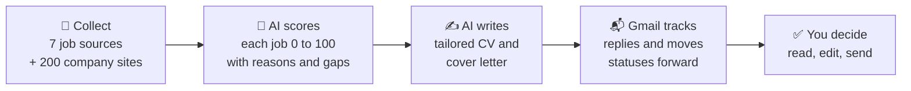

# Stellenpilot

**Every morning it finds new jobs, scores them against your CV and writes a tailored CV and cover letter for the best ones. Free, local, no account.**

[](https://pypi.org/project/stellenpilot/)
[](https://pypi.org/project/stellenpilot/)
[](https://github.com/srvskr1/stellenpilot/actions/workflows/tests.yml)
[](https://github.com/srvskr1/stellenpilot/blob/main/LICENSE)
[](https://stellenpilot.dev)
[](https://www.producthunt.com/products/stellenpilot)


<sub>All names, companies and jobs in this demo are fictional.</sub>

### What is new in 0.12.2

* **Blue Card check uses today's line.** Each job is checked against the line valid on the day you look, so the switch to new figures happens on 1 January by itself. The 2027 ceiling set by the cabinet (€106,200, so €53,100 and €48,108.60) is already in, marked as expected until the Bundesrat approves it.
* **Official source for each year.** "Where is this from?" now links the Interior Ministry's notice in the Bundesanzeiger for 2026 and the Federal Government's announcement for 2027. Thanks to Expath for pointing out how the lines are set.

### What is new in 0.12.1

* **Safer Blue Card check.** "Up to €60k" or "bis zu 60.000 €" is a ceiling, not the pay, so it no longer counts as the salary. Those jobs now show "ask in the interview" instead of a yes they may not deserve.
* **Blue Card lines follow the pension ceiling.** Both lines are worked out from the yearly pension contribution ceiling (50% and 45.3%), and the shortage line keeps its cents (€45,934.20).
* **Star on GitHub.** A new link at the bottom of the sidebar. If Stellenpilot helps you, a star helps others find it.

Older releases are on the [releases page](https://github.com/srvskr1/stellenpilot/releases).

**Windows and Mac:** [download the app](https://github.com/srvskr1/stellenpilot/releases/latest), no Python needed ([Mac first start](https://github.com/srvskr1/stellenpilot/blob/main/docs/mac.md))

**Mac or Linux with Homebrew:**

```bash
brew tap srvskr1/stellenpilot
brew trust --formula srvskr1/stellenpilot/stellenpilot
brew install stellenpilot
stellenpilot serve
```

**Linux or Python:**

```bash
pip install stellenpilot
stellenpilot serve
```

Drop your CV, say what you want, press **Download** for the built in AI, switch on the daily search. That's it. It also puts a Stellenpilot icon on your desktop, so next time you just double click. Windows, macOS and Linux, Python 3.11 or newer.

### Why try it

* **Private.** The built in AI runs on your computer. Your CV never leaves it.
* **Honest.** A truth guard rejects any sentence your CV does not back up, and every score comes with your real gaps.
* **Made for Germany.** 7 job boards plus about 200 company career pages, and it reads which German level an ad really needs. The app speaks English and German.
* **Easy to find.** Filter by word, source, type, place, day, match or status. The place and day lists follow your own settings, so what you search for is one click away.
* **You stay in control.** It never applies for you and never contacts a company.

## How it works



Every day, by itself:

1. **Collect.** Stellenpilot searches the Bundesagentur für Arbeit, Arbeitnow, Adzuna, TheirStack, Jobicy, Remotive and workingstudentjobs.de, plus the career pages of about 200 companies with offices in Germany. Duplicates are removed.
2. **Score.** The AI reads each ad against your CV and gives a match from 0 to 100, a short reason, and the honest gaps. It reads which German level the ad really asks for and skips ads far above yours.
3. **Write.** For the best matches it writes a CV and a cover letter tailored to that job, using only facts from your CV, as Word files and PDF.
4. **Track.** With Gmail connected, confirmations, interview invitations and rejections move each application forward on their own. Interviews get a prep pack.
5. **Report.** The dashboard (and, if you like, a Telegram or email digest) shows what is ready to send today.

**It never applies for you and never contacts a company.** The agent prepares; you stay in control of every application.

## The AI

### What the AI does for you

* **Reads your CV.** Drop a PDF or Word file and it becomes a structured profile. A CV with clear headings is sorted in about a second, without any AI; for other layouts the AI only points at line numbers, so even a laptop needs just a minute or two. Every word is copied from your CV, and anything left out is flagged.
* **Scores every job** from 0 to 100 with a one line reason and the honest gaps (for example "asks for dbt, which you are still learning").
* **Understands German job ads.** It finds the German level an ad really needs (A1 to C2, from phrases like "verhandlungssicher" or "gute Deutschkenntnisse"), compares it with yours, and writes an English summary of every German ad.
* **Tailors your CV.** It picks and orders the experience, projects and skills from your profile that matter most for this job, and chooses the best fitting headline. Three layouts: Classic, Compact, or a German Lebenslauf with dates first.
* **Writes the cover letter** in natural language for that company and role, plus a short report: what the ad asks for, what you cover, and which gaps to be honest about. German letters only if your German is B2 or better.
* **Prepares interviews** with likely questions and questions to ask them.
* **Learns your taste.** Mark jobs as a good match or not for you, and the next search leans toward what you liked.
* **Speaks English and German.** Pick the dashboard language in the first setup step or under Settings, Language. Automatic follows your browser. Your CVs and cover letters keep their own language setting.

### Truthful by design

A job assistant that invents experience gets people into trouble. Stellenpilot has a **truth guard**: any generated sentence that mentions a number, a tool or a language level your profile does not back up is rejected and replaced with safe text. Skills in a group called "Learning" (or "Lernen") are never presented as experience. The AI rephrases and selects; it never adds facts.

### Measured, not assumed

`stellenpilot eval` checks how well the scores rank the jobs you labeled (thumbs, interviews, or a sheet you fill in), and compares the stored score, keyword scoring and any AI you name: Spearman correlation, AUC, precision at 10, and how many good jobs pass `min_match`. Use it to pick a model and a threshold on your own data. See [docs/evaluation.md](https://github.com/srvskr1/stellenpilot/blob/main/docs/evaluation.md)

First results on 28 real jobs: AUC 0.73 for the stored score and 0.75 for keywords, and 9 of the top 10 were jobs worth applying to. The built-in AI does not beat keywords yet, and the default `min_match` of 70 skips most good jobs. Full numbers and limits in [docs/results.md](https://github.com/srvskr1/stellenpilot/blob/main/docs/results.md)

### Choose your AI

| | Built-in AI | Ollama, LM Studio, llama.cpp | Claude or OpenAI | No AI |
|---|---|---|---|---|
| Setup | one **Download** button | install the app, pull a model | paste an API key | nothing |
| Cost | free | free | a few cents a day | free |
| Privacy | stays on your computer | stays on your computer | CV and ads go to the provider | stays on your computer |
| Writing | good | depends on the model | best | templates |
| Speed | slower (see below) | depends on your computer | fast | instant |

**Built-in AI** is the default for new users. Pick it in setup or in **Settings, AI model** and press **Download**. Stellenpilot downloads the [llama.cpp](https://github.com/ggml-org/llama.cpp) engine and an open Qwen3.5 model (Apache 2.0) once, into `~/.stellenpilot/ai`. It starts by itself when a search needs it and stops when the search is done.

| model | download | memory | writing |
|---|---|---|---|
| Standard: Qwen3.5 4B (default) | 2.7 GB | about 6 GB free | better |
| Light: Qwen3.5 2B | 1.3 GB | runs with 8 GB in total | simpler, about twice as fast |

**How fast is it?** It runs on your processor, so it is slower than Claude, but free and private:

* Standard on a typical laptop: about 20 to 40 seconds to score one job, and 1 to 2 minutes for a CV with its cover letter. Light is about twice as fast.
* To keep searches short, an AI on your own computer reads the 20 most promising new jobs of each search (picked by keywords); the others keep a keyword score. Change it with `max_ai_jobs` under `[llm]`.
* A daily search with the AI takes about 10 to 20 minutes with Standard, or 5 to 10 with Light, in the background. Without AI it takes a minute or two.
* Measured on our small test server with only 2 processor cores: Standard needed 67 seconds per job and 2 minutes per CV and letter; Light 32 seconds and about 1 minute. Older laptops can be that slow; newer ones and Macs with Apple chips are faster.
* After the download, **Test speed** in Settings measures your own computer.

The laptop figures are estimates from published CPU benchmarks for these model sizes, not measured on every computer.

<details>
<summary><b>Using your own local model or a cloud API</b></summary>

Set `[llm]` in `config.toml`, or choose it in **Settings, AI model**:

| provider | what you need | notes |
|---|---|---|
| `builtin` | press Download once in Settings | Local and free, set up by Stellenpilot. `model = "standard"` or `"light"`. |
| `ollama` | Ollama running, a pulled model | Local and free. |
| `lmstudio` | LM Studio with its server started | Local and free. |
| `llamacpp`, `vllm`, `local` | a running server | Any OpenAI compatible local server. |
| `anthropic` | `ANTHROPIC_API_KEY` in `.env` | Claude through the Anthropic API. |
| `openai` | `OPENAI_API_KEY` in `.env` | OpenAI API. |
| `none` | nothing | Keyword scoring and template letters. |

Which local model for Ollama or LM Studio? Pick an instruction tuned version, because the tool asks for JSON answers.

| your computer | try | download |
|---|---|---|
| 8 GB RAM, no GPU | `ministral-3:3b` or `qwen3.5:2b`. Expect rougher scores and shorter letters. | about 3 GB |
| 16 GB RAM, or a GPU with 8 GB | `qwen3.5:4b` (default pick), or `ministral-3:8b` if many of your ads are in German | 4 to 6 GB |
| GPU with 16 GB or more | `qwen3.5:9b` or `gemma4:12b` | 7 to 9 GB |

Why these (checked on their model cards, October 2026): all are Apache 2.0, run in Ollama, and handle JSON well. Qwen3.5 covers 201 languages; Ministral 3 lists German among its main languages and is built for JSON output; Gemma 4 is Google's newest small family. Qwen3.5 and Gemma 4 can "think" before answering, which makes them slow; Stellenpilot switches that off for Ollama (set `think = true` under `[llm]` to turn it back on).

What we saw in testing with a very small model (Qwen2.5 1.5B on 2 CPU cores): the pipeline worked end to end, the German check and the truth guard did their job, and the cover letter stayed truthful. But the model gave every job the same score and wrote a two sentence letter, and each answer took about a minute. Small models are fine for trying the setup, not for real use.

Full setup for Ollama, LM Studio, llama.cpp, vLLM and Docker, plus speed tips and troubleshooting: [docs/local-llm.md](https://github.com/srvskr1/stellenpilot/blob/main/docs/local-llm.md), and run `stellenpilot doctor` to check that your model server is reachable and the model is installed.

</details>

## Automation

* **Daily autopilot.** Switch on **Automatic search** in Settings and pick a time. Stellenpilot sets up Task Scheduler on Windows or cron on macOS and Linux for you. The dashboard does not need to be open. A search missed because the computer was off runs when you log in or open Stellenpilot. Doing it by hand: [docs/scheduling.md](https://github.com/srvskr1/stellenpilot/blob/main/docs/scheduling.md)
* **Company watchlist.** Switch on the ready made list of about 200 companies with offices in Germany, or add your dream companies that use Greenhouse, Lever, Ashby, Personio or SmartRecruiters. Their new roles often appear here before they reach the job boards.
* **Email sync.** Read only. Connect Gmail (or GMX, web.de and others) in **Settings, Email** with your address and an app password, in about 2 minutes, and statuses move forward as replies arrive. It never sends, deletes, moves or labels mail. If your Google account has no app passwords, use your own Google key file instead: run `stellenpilot gmail --install` in a terminal, then follow the steps the dashboard shows. Details: [docs/gmail.md](https://github.com/srvskr1/stellenpilot/blob/main/docs/gmail.md)
* **Daily digest** to Telegram or email: top new matches, documents ready to send, interviews. See [docs/digest.md](https://github.com/srvskr1/stellenpilot/blob/main/docs/digest.md)
* **Jobs you found yourself.** Paste a link or the ad text from LinkedIn, a friend or anywhere, and the AI scores and tailors it like the rest.

## The dashboard

Five calm pages, in your browser, on your computer:

* **Home**: what is ready to apply, interviews coming up, the newest matches, and a small 3D office where a robot works through each step of the search.
* **Jobs**: every job with its score, why it fits, honest gaps, your documents, notes and interview prep. Filter by word, source, type, place, day, match or status, and see which tools of the ad you have, which ones you are missing, and what the job would score with each of them.
* **Applications**: a board you drag cards across (Applied, Interview, Offer, Rejected). Below it, Insights shows reply rates by source and CV layout, where your applications stop (CV, first check or interviews), a follow up email for interviews that went quiet, how many English ads still want good German, the skills that would open the most jobs for you, and a weekly summary.
* **My CV**: your profile, with tips to improve your matches.
* **Settings**: language (English or Deutsch), job sources, the AI, the daily search and Gmail, with step by step help for every key.

Something broken? **Report a bug** in the sidebar or in Settings opens the bug report form on GitHub.

## Install

### Windows: download the app (easiest)

**[Download Stellenpilot for Windows](https://github.com/srvskr1/stellenpilot/releases/latest)** (the file `Stellenpilot-Setup-X.Y.Z.exe`, about 27 MB). Python is included, nothing else to install. Run it, then double click **Stellenpilot** on your desktop.

Windows may say "Windows protected your PC" because the app is not code signed yet. Click **More info**, then **Run anyway**. The installer is built by GitHub straight from this repository.

### Mac: download the app

**[Download Stellenpilot for Mac](https://github.com/srvskr1/stellenpilot/releases/latest)** (the file `Stellenpilot-X.Y.Z-mac.dmg`, for Macs with an Apple chip). Open it and drag Stellenpilot into Applications.

The app is not signed by Apple yet, so macOS stops it the first time: on macOS 15 and newer, open **System Settings, Privacy & Security** and click **Open Anyway**. Step by step, with the fix for older macOS and for a "damaged" message: [docs/mac.md](https://github.com/srvskr1/stellenpilot/blob/main/docs/mac.md), and the disk image is built by GitHub straight from this repository.

### Mac and Linux: Homebrew

```bash
brew tap srvskr1/stellenpilot
brew trust --formula srvskr1/stellenpilot/stellenpilot
brew install stellenpilot
mkdir -p ~/Stellenpilot && cd ~/Stellenpilot
stellenpilot serve
```

Update with `brew upgrade stellenpilot`. The formula moves to each new version on its own one to two days after the release (Homebrew waits a day before it takes a new PyPI upload), and the daily search and desktop icon keep working across updates. Homebrew 7 and newer asks you to trust a tap before installing from it, which is the `brew trust` line. Homebrew builds Stellenpilot on your Mac, so there is no "unidentified developer" warning.

### With Python (Windows, macOS, Linux)

**New to Python or the terminal?** Follow [INSTALL.md](https://github.com/srvskr1/stellenpilot/blob/main/INSTALL.md): step by step for Windows, macOS, Linux and Docker, from installing Python to your first search.

```bash
pip install stellenpilot
mkdir my-hunt
cd my-hunt
stellenpilot serve      # the browser opens by itself, and so does setup
```

**Starting it again later:** double click the **Stellenpilot** icon on your desktop. Setup offers to create it; you can also do it under **Settings, Desktop icon** or with `stellenpilot shortcut`. Keep the small window it opens running while you use Stellenpilot, and close it when you are done. The daily search does not need it.

**"stellenpilot is not recognized"?** pip put the command in a folder that is not on your PATH. Use `python -m stellenpilot serve` instead (`python3` on macOS and Linux). That always works.

Update with `pip install -U stellenpilot`. Your files in `my-hunt` are never touched by an update.

<details>
<summary><b>From source, or with Docker</b></summary>

**From the source code** instead: you need Python 3.11 or newer (or Docker, see below). Works on Windows, macOS and Linux. On Debian or Ubuntu also install `python3-venv`. On Windows use `python` where the commands below say `python`; on macOS and Linux it may be `python3`.

```bash
git clone https://github.com/srvskr1/stellenpilot.git
cd stellenpilot
python -m venv .venv
# Windows: .venv\Scripts\activate    macOS or Linux: source .venv/bin/activate
pip install -e .

mkdir my-hunt
cd my-hunt
stellenpilot init      # creates config.toml, profile.toml and .env
stellenpilot demo      # optional: fictional sample jobs, to look around first
stellenpilot serve     # open http://127.0.0.1:8765
```

Prefer Docker? No Python needed:

```bash
mkdir data
docker compose build
docker compose run --rm stellenpilot init
docker compose up -d      # http://127.0.0.1:8765
```

See [docs/docker.md](https://github.com/srvskr1/stellenpilot/blob/main/docs/docker.md) for daily runs and details.

</details>

Prefer files to the dashboard? Everything also lives in `profile.toml`, `config.toml` and `.env`, `stellenpilot run` searches from the terminal, and `stellenpilot doctor` checks the setup.

## Job sources

| source | key | cost and limits | terms you should know |
|---|---|---|---|
| Bundesagentur für Arbeit | none | free | Community documented endpoint (jobsuche.api.bund.dev). No published limits, so requests are kept small. |
| Arbeitnow | none | free | Their terms require a link back to arbeitnow.com. The dashboard shows it. |
| Adzuna | free, from developer.adzuna.com | default 250 calls a day | Allowed for personal research. Adzuna must be credited; every Adzuna job links to Adzuna. Returns short snippets, not full ads. |
| TheirStack | free, from theirstack.com | 200 credits a month, 1 credit per job | Keys may not be shared. Each user needs their own. |
| Jobicy | none | free, one pass an hour at most | Remote jobs only. Credit Jobicy with a link to the listing; the dashboard does this. |
| Remotive | none | free, about 4 calls a day at most | Remote jobs only, one call per run. Small feed, delayed by a day. Credit and link back to Remotive; the dashboard does this. |
| workingstudentjobs.de | none | free, one call per city | Free Werkstudent and internship API for German cities. Every job links to its apply_url, and the listings must not be re-hosted as a competing board. The feed has no ad text, so only title, skills, language and field are scored. |

There is no LinkedIn, StepStone or Indeed scraper on purpose. LinkedIn's and StepStone's terms forbid scraping, and Indeed has no public job search API. See [docs/sources.md](https://github.com/srvskr1/stellenpilot/blob/main/docs/sources.md) for the details and links.

Other countries: set `country` in `config.toml`. Adzuna covers 19 countries, Jobicy and Remotive cover remote roles open to your country, TheirStack and the company watchlist cover any country, and the Bundesagentur, Arbeitnow and workingstudentjobs.de cover Germany only.

## Privacy and safety

* **Local first.** Everything is stored in `jobhunt.db` and the `output` folder next to your config, on your computer. With the built-in AI or another local model, nothing about you leaves it.
* With Claude or OpenAI, your profile and the job ads are sent to that provider.
* The dashboard listens on 127.0.0.1 only, and write requests need a custom header, so other websites cannot change your data through your browser.
* **Updates.** Once a day Stellenpilot asks GitHub whether a newer version exists. That request carries only the version number, never your data, and you can switch it off under Settings, Language. If there is one, Home shows a **Download** button for the installer from the Stellenpilot releases. Run it and it updates your app in place; your workspace is never touched. Stellenpilot itself never downloads or runs anything.
* Read every document before you send it. The truth guard checks digits and the tools it knows (see `VOCAB` in `stellenpilot/score.py`). It cannot judge spelled out numbers or vague claims, so you are the final check.
* Why the server, the guards, the link fetcher and the AI downloads are built the way they are: [docs/architecture.md](https://github.com/srvskr1/stellenpilot/blob/main/docs/architecture.md)

## Commands

| command | does |
|---|---|
| `stellenpilot init` | create config, profile and .env from the examples |
| `stellenpilot doctor` | check the setup and keys |
| `stellenpilot run` | search, score, tailor, and sync Gmail if enabled |
| `stellenpilot run --no-tailor` | search and score only |
| `stellenpilot serve` | start the dashboard on 127.0.0.1:8765 and open it in the browser (`--no-browser` to skip) |
| `stellenpilot shortcut` | put a Stellenpilot icon on the desktop that starts this workspace |
| `stellenpilot gmail` | sync statuses from Gmail once |
| `stellenpilot gmail --install` | install the Google packages for the own key file way of Gmail sync |
| `stellenpilot demo` | load fictional sample jobs |
| `stellenpilot import cv.pdf` | turn your CV into `profile.imported.toml` to review |
| `stellenpilot add LINK` | add a job from a careers page link |
| `stellenpilot add --text ad.txt --title "..." --company "..." --tailor` | add a pasted ad and tailor it now |
| `stellenpilot watch LINK` | find the watchlist entry for a company |
| `stellenpilot eval` | measure how well scoring ranks the jobs you labeled ([docs/evaluation.md](https://github.com/srvskr1/stellenpilot/blob/main/docs/evaluation.md)) |
| `stellenpilot eval --make-sheet` | write 100 jobs to label by hand in `eval/labels.csv` |
| `stellenpilot notify-test` | send a test digest |
| `stellenpilot telegram-id` | show your Telegram chat id |

Use `--home PATH` to keep your files in another folder.

## Project layout

```
stellenpilot/
  sources/      one module per job API
  pipeline.py   the daily run: collect, score, tailor, Gmail
  score.py      LLM or keyword scoring, taste from your ratings
  evaluate.py   scoring evaluation: labels, metrics, model comparison
  tailor.py     truthful CV plan, DOCX, cover letter, report, PDF
  server.py     local dashboard API
  web/          dashboard page
  examples/     example config and profile
tests/          offline tests: python -m unittest discover -s tests
```

## Uninstall completely

Do these steps in order. Steps 1 and 2 matter most: they stop the daily search before the program is gone.

**1. Stop the dashboard.** Press **Ctrl+C** in the terminal where `stellenpilot serve` runs (Docker: `docker compose down`).

**2. Remove the automatic daily search**, if you switched it on. Easiest: in the dashboard open **Settings**, switch off **Search every day** under Automatic search and press **Save changes**. If the dashboard is already gone:

* Windows (PowerShell): `schtasks /Delete /TN "Stellenpilot daily search" /F`
* macOS and Linux: run `crontab -e` and delete the line that ends with `# jobhunt-daily`

**3. Remove the program.**

* Windows app: Windows Settings, Apps, Stellenpilot, Uninstall. It also removes the daily search task. Your files in `Documents\Stellenpilot` stay; delete that folder too if you want everything gone.
* Installed with Homebrew: `brew uninstall stellenpilot`, then `brew untap srvskr1/stellenpilot`. Your workspace folder (for example `~/Stellenpilot`) stays until you delete it.
* Installed with pip: activate the environment you installed it in, then `pip uninstall stellenpilot`. Delete that environment folder too if you made one just for it (for example `stellenpilot-env` or `.venv`).
* Installed from source: delete the `stellenpilot` folder you cloned or unzipped (the environment `.venv` is inside it).
* Docker: in the project folder run `docker compose down`, then `docker rmi ghcr.io/srvskr1/stellenpilot` (and `docker image prune` to free the space of any self built image).

**4. Delete your data.** Your workspace folder (`my-hunt`, or `data` for Docker) holds everything personal: your CV profile, `.env` with your API keys, the job database, the generated CVs and cover letters, `run.log`, backups and the Gmail `token.json`. Delete the whole folder. The only other place is the Built-in AI folder `.stellenpilot` in your home folder, if you downloaded it (see step 5).

**5. Close your accounts and keys** (optional, but good practice):

* API keys you created for it: delete them at Adzuna, TheirStack, Anthropic or OpenAI.
* Gmail sync: remove access at https://myaccount.google.com/permissions and delete the Google Cloud project you made for it.
* Telegram digest: send `/deletebot` to @BotFather.
* Built-in AI: press **Remove the AI files** in Settings, or delete the folder `.stellenpilot` in your home folder (`C:\Users\<you>\.stellenpilot` on Windows). It holds the engine and the model, about 1.5 to 4 GB.
* Ollama model: `ollama rm qwen3.5:4b` (or the model you pulled), and uninstall Ollama or LM Studio if you only used them for this.

LibreOffice and Python stay installed; remove them like any other app if you no longer need them.

## Contributing

Issues and pull requests are welcome. Found a bug? [Open a bug report](https://github.com/srvskr1/stellenpilot/issues/new?template=bug_report.md); it is public, so leave out API keys and CV details. Read [docs/architecture.md](https://github.com/srvskr1/stellenpilot/blob/main/docs/architecture.md) first, it explains the decisions that are easy to undo by accident. New sources should use an official or clearly permitted API, follow the shape in `stellenpilot/sources/__init__.py`, and come with an offline test.

## How it was built

Built with an AI pair programmer, decisions are mine.

## Credits and license

MIT, see [LICENSE](https://github.com/srvskr1/stellenpilot/blob/main/LICENSE), and credits for ideas and data are in [NOTICE.md](https://github.com/srvskr1/stellenpilot/blob/main/NOTICE.md), and the built-in AI uses [llama.cpp](https://github.com/ggml-org/llama.cpp) (MIT) and [Qwen3.5](https://huggingface.co/Qwen) models (Apache 2.0), downloaded from their official sources.
